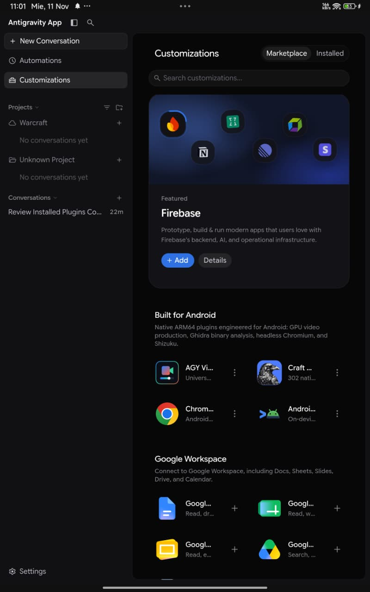

<div align="center">

  <h1 align="center">Antigravity Android Native Plugins Marketplace</h1>

  <p><font color="#7d8590">Official live OTA repository of native <b>ARM64 / Bionic</b> plugins, MCP servers, and skills engineered by <a href="https://github.com/Yhoanes"><b>Yhoanes</b></a> for <a href="https://github.com/Yhoanes/antigravity-android"><b>Antigravity for Android</b></a> (<a href="https://yhoanes.github.io/antigravity-android/">Website</a>).</font></p>

  <p>
    <code>ARM64 v8.0-A+</code> &nbsp;&bull;&nbsp;
    <code>GPU h264_mediacodec</code> &nbsp;&bull;&nbsp;
    <code>Remotion 4.0 Studio (Rust)</code> &nbsp;&bull;&nbsp;
    <code>Craft Anything + Ghidra 12.1.4</code> &nbsp;&bull;&nbsp;
    <code>Unity 6 Studio + CLI (Rust)</code> &nbsp;&bull;&nbsp;
    <code>Game Studio 2D/3D (Rust)</code> &nbsp;&bull;&nbsp;
    <code>GitHub MCP 91 Tools</code> &nbsp;&bull;&nbsp;
    <code>Headless Chromium MCP</code> &nbsp;&bull;&nbsp;
    <code>Shizuku Ready</code>
  </p>

  <br/>

  
  <p align="center"><font size="2" color="#7d8590">Live <b>Built for Android</b> shelf inside Antigravity for Android (Customizations &rarr; Marketplace)</font></p>

</div>

---

## Overview

**Antigravity for Android** (`v2.31.1+`) merges this live catalog (`catalog.json`) directly into **Customizations &rarr; Marketplace**, placing the **`Built for Android`** 2-column shelf right above **Google Workspace** while automatically redirecting incompatible desktop x86/Electron plugins to clean, Bionic-ready ARM64 builds.

* **Live OTA Updates (Zero APK Rebuilds):** Every plugin update or newly published Android plugin in this repository appears automatically in the in-app Marketplace.
* **Auto-Enabled on Install:** Tapping **`+`** extracts the archive, normalizes Android `$HOME` / `$PREFIX` paths, configures executable permissions, and enables the plugin (`enabled: true`) immediately.

Live catalog endpoint:
```text
https://raw.githubusercontent.com/Yhoanes/antigravity-android-plugins/main/catalog.json
```

---

## `Built for Android` Catalog

| # | Plugin | Catalog ID | Version | Capabilities |
| :-: | :--- | :--- | :---: | :--- |
| **1** | **AGY Video Studio** | `antigravity-plugins-official/plugin/agy-video-studio` | `2.1.3` | **14 MCP tools:** 16:9 YouTube, Vlogs, Split-Screen Podcasts, 9:16 TikTok/Reels & 60fps Keynote trailers via Android hardware GPU (`h264_mediacodec`), neural ES/EN/PT voiceover (`edge-tts`), procedural ambient music, rootless CapCut drafts & Shizuku UI automation. |
| **2** | **Craft Anything + Ghidra** | `antigravity-plugins-official/plugin/craft-anything` | `0.5.0` | **335 native ARM64 Rust MCP tools** (`craft-anything-cli` + `craft-plus-mcp` LSE) for static triage of `ELF`, `PE`, `Mach-O`, `APK/DEX`, `.NET & NativeAOT`, `WASM`, `CUDA/PTX`, `ESP32/UF2/DTB`, `Godot .pck`, `Unity IL2CPP`, `Wii/GC .dol -> ELF` & stateful **RL `.har` mock environments** + on-demand native ARM64 **Ghidra 12.1.4** (`decompile`, `sleigh` & `ghidra_headless_run`). |
| **3** | **Game Studio 2D/3D** | `antigravity-plugins-official/plugin/game-studio` | `2.0.0` | **16 native ARM64 Rust MCP tools + `GDExtension` (`C/C++` & `Rust`) + Zero-Cloud Local `.apk` Compiler:** **Godot 4.7 Vulkan (120–144 FPS)** 2D/3D touch projects, native `arm64-v8a` `.so` compilation in `<1s`, local signed `.apk` build/deploy (`apksigner` v2/v3 + HTTP-Range template saving `>1 GB`), `.gdshader` + `MultiMesh` GPU Instancing (`5,000+` units), Sprite Atlas (`PNG/WebP/TGA/DDS`), 3D `.glb` LODs, `0 ms` WAV DSP & `144 Hz` live `logcat -s godot` debugger via `rish`. |
| **4** | **GitHub (Local ARM64 MCP)** | `antigravity-plugins-official/plugin/github` | `2.1.1-android` | **91 native ARM64 GitHub MCP tools** (`github-mcp-server` `v2.1.0` without Docker: repos, PRs, code reviews, issues, Actions CI/CD logs, Dependabot & security) + 1-command Bionic `git`/`gh` OAuth bridge (`github-mcp-setup`). |
| **5** | **Chrome DevTools (Android)** | `antigravity-plugins-official/plugin/chrome-devtools-plugin` | `1.10.4-android` | Headless ARM64 Chromium (`--no-sandbox`) MCP launcher + all 6 official Chrome DevTools web debugging, LCP & accessibility skills. |
| **6** | **Android CLI (On-Device)** | `antigravity-plugins-official/plugin/android-cli-plugin` | `1.0.16625373-android` | Bundles the on-device `android` CLI bridge (`status`, `devices`, `layout`, `screen capture`, `install`, `shell` via Shizuku `rish`) + official Android & Jetpack Compose skills. |
| **7** | **Science (Android Clean)** | `antigravity-plugins-official/plugin/science` | `1.3.2-android` | All 28 official Science skills (AlphaFold, ChEMBL, PubMed, RDKit, genomics & structure analysis) pre-cleaned for Android ARM64 without desktop Electron sidecars. |
| **8** | **AGY ADB Bridge** | `antigravity-plugins-official/plugin/agy-adb-bridge` | `1.0.1` | **7 MCP tools + CLI Rust ARM64:** Puente nativo `uid=2000(shell)` sin Shizuku externo mediante `android-tools` (`adb`), llave RSA persistente, modo local `127.0.0.1:5555` inmune a apagar Wi-Fi, mDNS UDP 0% batería y wrapper auto-reparable `$PREFIX/bin/rish` con watchdog de 2s para MIUI/HyperOS. |
| **9** | **Unity Studio Android** | `antigravity-plugins-official/plugin/unity-android` | `1.0.0` | **13 native ARM64 Rust MCP tools + Ported Official `unity-cli v1.0.0`:** Proyectos **Unity 6.3 LTS (`6000.3.28f1` Personal)** 2D/3D a 120–144 FPS (`arm64-v8a` IL2CPP), serializador/auditor YAML de escenas `.unity`/`.prefab` y GUIDs `.meta`, shader `NeonLit` anti-stripping, `.unitypackage` offline, `$0` GitHub Actions `GameCI` / Cloud Build, auto-instalación APK y Live Debugger (`logcat -s Unity` + FPS/RAM) vía `rish`. |
| **10** | **Remotion Studio Android** | `antigravity-plugins-official/plugin/agy-remotion` | `1.0.1` | **10 native ARM64 Rust MCP tools + Ported Official Remotion `v4.0.544` Engine:** Compositor Rust `musl` ARM64 + FFmpeg 7.1 (`remotionshm`), renderizado programático React/TypeScript a **60 FPS** (`saas_launch`, `apple_keynote`, `viral_reels_9_16`, `code_walkthrough`, `data_charts`), proyectos `<50 KB` compatibles con `/sdcard` (`noexec`-safe), vista previa interactiva **Remotion Studio** en vivo (`127.0.0.1:3100`), `@remotion/captions`, aceleración GPU `h264_mediacodec` y Skills oficiales de Remotion. |

---

## Optional On-Demand Toolchains

Each plugin connects its MCP server immediately upon installation (`<1s` zero-day readiness) and keeps heavy runtime dependencies optional so user storage stays lean until needed:

| Plugin | One-Time Setup Command (run inside Antigravity chat or terminal) | What It Unlocks |
| :--- | :--- | :--- |
| **AGY Video Studio** | `agy-video-setup` | Installs native ARM64 `python`, `ffmpeg` (`h264_mediacodec` GPU), `Pillow`, `NumPy` & `edge-tts`, activating all 14 video production tools. |
| **Craft Anything + Ghidra** | `craft-ghidra-setup` *(optional — 335 Rust tools work immediately with 0 downloads)* | Downloads & configures `openjdk-21` + **Ghidra 12.1.4 PUBLIC** (~450 MB) and injects native ARM64 `decompile` & `sleigh`. |
| **Game Studio 2D/3D** | `agy-game-studio setup` *(optional — all 16 Rust MCP tools work immediately)* | Patches headless **Godot 4.7** (`godot-bin`), dumps `gdextension_interface.h`, configures Android keystore/SDK, and extracts `android_debug.apk` (~120 MB via HTTP Range, saving >1.1 GB) for 100% offline local `.apk` builds. |
| **GitHub** | `github-mcp-setup` *(automatic if already logged into `gh`)* | Launches Android browser OAuth login (`https://github.com/login/device`), configures Bionic `git` (`GODEBUG=netdns=cgo`, `GIT_EXEC_PATH`, `.netrc`), and unlocks all 91 local GitHub MCP tools. |
| **Chrome DevTools** | `pkg update && pkg install nodejs chromium` | Enables live headless ARM64 Chromium DOM/network/performance automation via `chrome-devtools-mcp`. |
| **Android CLI** | Start the **Shizuku** app on Android | Enables live `android layout`, `android screen capture`, `android install`, and `rish` ADB shell operations on-device. |
| **AGY ADB Bridge** | `agy-adb setup && agy-adb pair <6-digitos>` (o **vía chat** con `adb_bridge_pair`) | Puente nativo `uid=2000(shell)` en `127.0.0.1:5555` con llave RSA persistente sin depender de Shizuku ni de Wi-Fi tras vincular una vez. |
| **Unity Studio Android** | `agy-unity setup && unity auth login` *(13 Rust MCP tools work immediately with 0 downloads)* | Downloads & patches official **`unity-cli v1.0.0` (`linux-arm64`)** + isolated `glibc` runtime + `ENOSYS` syscall shim, unlocking `unity docs`, `unity vcs`, `unity releases`, `unity projects`, and `unity pipeline cloud-build`. |
| **Remotion Studio Android** | `agy-remotion-setup` *(o vía chat con `remotion_setup`; el servidor MCP en Rust arranca al instante)* | Instala `chromium` + `ffmpeg` ARM64, configura el motor compartido **Remotion `v4.0.544`** en `$PREFIX/opt/remotion-engine` y enlaza `@remotion/compositor-linux-arm64-musl` con su micro-runtime `musl` (`~2 MB`). |

---

<div align="center">
  <p><font color="#7d8590">Part of <a href="https://github.com/Yhoanes/antigravity-android"><b>Antigravity for Android</b></a> &nbsp;&bull;&nbsp; Copyright &copy; 2026 <a href="https://github.com/Yhoanes">Yhoanes</a></font></p>
</div>
