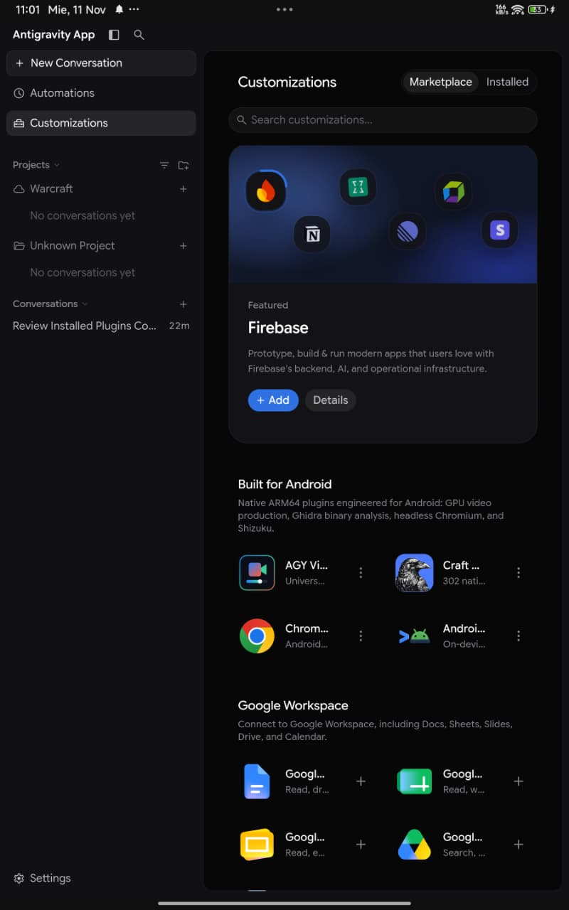

<div align="center">

  <p><font size="6"><b>Antigravity Android Native Plugins Marketplace</b></font></p>

  <p><font color="#7d8590">Official live OTA repository of native <b>ARM64 / Bionic</b> plugins, MCP servers, and skills engineered for <a href="https://github.com/Yhoanes/antigravity-android"><b>Antigravity for Android</b></a>.</font></p>

  <p>
    <code>ARM64 v8.0-A+</code> &nbsp;&bull;&nbsp;
    <code>GPU h264_mediacodec</code> &nbsp;&bull;&nbsp;
    <code>Craft Anything + Ghidra 12.1.4</code> &nbsp;&bull;&nbsp;
    <code>Headless Chromium MCP</code> &nbsp;&bull;&nbsp;
    <code>Shizuku Ready</code>
  </p>

  <br/>

  
  <p align="center"><font size="2" color="#7d8590">Live <b>Built for Android</b> shelf inside Antigravity for Android (Customizations &rarr; Marketplace)</font></p>

</div>

---

## Overview

**Antigravity for Android** (`v2.31.1+`) merges this live catalog (`catalog.json`) directly into **Customizations &rarr; Marketplace**, placing the **`Built for Android`** 2-column shelf right above **Google Workspace** while automatically redirecting incompatible desktop x86/Electron plugins to clean, Bionic-ready ARM64 builds.

* **Live OTA Updates (Zero APK Rebuilds):** Every plugin update or newly published Android plugin in this repository appears automatically in the in-app Marketplace.
* **Auto-Enabled on Install:** Tapping **`+`** extracts the archive, normalizes Android `$HOME` / `$PREFIX` paths, configures executable permissions, and enables the plugin (`enabled: true`) immediately.

Live catalog endpoint:
```text
https://raw.githubusercontent.com/Yhoanes/antigravity-android-plugins/main/catalog.json
```

---

## `Built for Android` Catalog

| # | Plugin | Catalog ID | Version | Capabilities |
| :-: | :--- | :--- | :---: | :--- |
| **1** | **AGY Video Studio** | `antigravity-plugins-official/plugin/agy-video-studio` | `2.1.2` | **14 MCP tools:** 16:9 YouTube, Vlogs, Split-Screen Podcasts, 9:16 TikTok/Reels & 60fps Keynote trailers via Android hardware GPU (`h264_mediacodec`), neural ES/EN/PT voiceover (`edge-tts`), procedural ambient music, rootless CapCut drafts & Shizuku UI automation. |
| **2** | **Craft Anything + Ghidra** | `antigravity-plugins-official/plugin/craft-anything` | `0.4.0-r7` | **302 native ARM64 Rust MCP tools** (`craft-anything-cli --deep mcp --all-tools`) for static triage of `ELF`, `PE`, `Mach-O`, `APK/DEX`, `.NET`, `WASM` & `Electron/JS` + on-demand native ARM64 **Ghidra 12.1.4** (`decompile` & `sleigh`). |
| **3** | **Chrome DevTools (Android)** | `antigravity-plugins-official/plugin/chrome-devtools-plugin` | `1.10.2-android` | Headless ARM64 Chromium (`--no-sandbox`) MCP launcher + all 6 official Chrome DevTools web debugging, LCP & accessibility skills. |
| **4** | **Android CLI (On-Device)** | `antigravity-plugins-official/plugin/android-cli-plugin` | `1.0.16625371-android` | Bundles the on-device `android` CLI bridge (`status`, `devices`, `layout`, `screen capture`, `install`, `shell` via Shizuku `rish`) + official Android & Jetpack Compose skills. |
| **5** | **Science (Android Clean)** | `antigravity-plugins-official/plugin/science` | `1.3.0-android` | All 28 official Science skills (AlphaFold, ChEMBL, PubMed, RDKit, genomics & structure analysis) pre-cleaned for Android ARM64 without desktop Electron sidecars. |

---

## Optional On-Demand Toolchains

Each plugin connects its MCP server immediately upon installation (`<1s` zero-day readiness) and keeps heavy runtime dependencies optional so user storage stays lean until needed:

| Plugin | One-Time Setup Command (run inside Antigravity chat or terminal) | What It Unlocks |
| :--- | :--- | :--- |
| **AGY Video Studio** | `agy-video-setup` | Installs native ARM64 `python`, `ffmpeg` (`h264_mediacodec` GPU), `Pillow`, `NumPy` & `edge-tts`, activating all 14 video production tools. |
| **Craft Anything + Ghidra** | `craft-ghidra-setup` *(optional — 302 Rust tools work immediately with 0 downloads)* | Downloads & configures `openjdk-21` + **Ghidra 12.1.4 PUBLIC** (~450 MB) and injects native ARM64 `decompile` & `sleigh`. |
| **Chrome DevTools** | `pkg update && pkg install nodejs chromium` | Enables live headless ARM64 Chromium DOM/network/performance automation via `chrome-devtools-mcp`. |
| **Android CLI** | Start the **Shizuku** app on Android | Enables live `android layout`, `android screen capture`, `android install`, and `rish` ADB shell operations on-device. |

---

<div align="center">
  <p><font color="#7d8590">Part of <a href="https://github.com/Yhoanes/antigravity-android"><b>Antigravity for Android</b></a> &nbsp;&bull;&nbsp; Copyright &copy; 2026 <a href="https://github.com/Yhoanes">Yhoanes</a></font></p>
</div>
